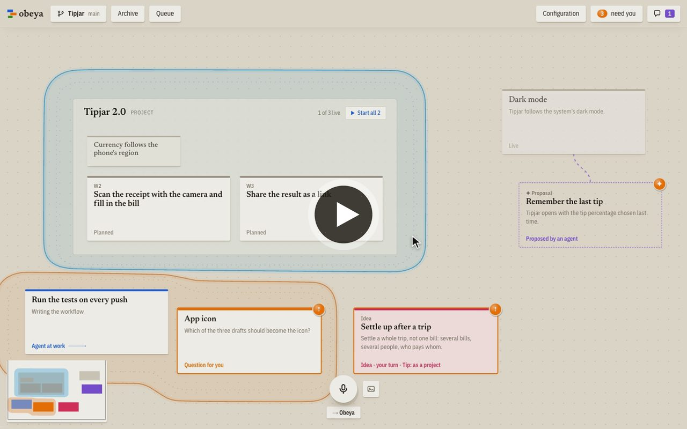
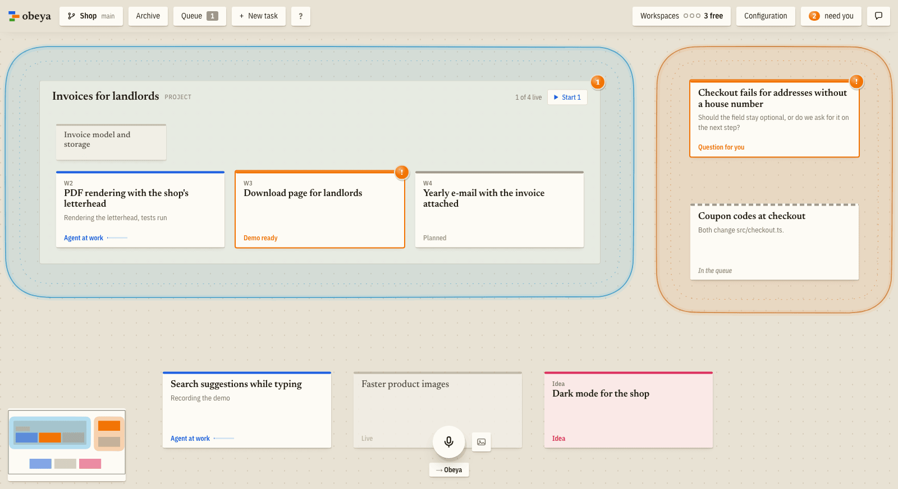

<h1>
  <picture>
    <source media="(prefers-color-scheme: dark)" srcset="src/ui/logo/wordmark-dark.svg">
    
  </picture>
</h1>

A spatial workspace for directing AI coding agents the way an engineering director directs a
team. Every task and every project is a card on one canvas. Agents do the work in the
background; you keep every essential decision — made by voice, from a narrated demo of the
finished work, without reading code or cycling through terminals.

*Obeya* is Japanese for "big room": in lean management, the room where every project hangs
visibly on the walls. More on [obeya.si](https://obeya.si).

[](https://obeya.si/#film)

The video shows Obeya at work in two minutes: an idea is said into the microphone, an agent builds
it and records its demo, and the approval lands it on `main` ([watch on obeya.si](https://obeya.si/#film),
with captions).

Each card gets its own agent (Claude Code) in its own clone or worktree of your repository, on
this machine or on another one reached over SSH. The agent asks on the card when it needs a
decision and hands over with a narrated demo video of the change. You approve it or say what to
change, also about one moment of the video: what you type or say while it stands there goes to the
agent with that frame and the narration's sentence. Approved work lands on `main` or goes out as a
pull request that Obeya carries to the merge; beside the branch the card shows how large the change
is, and a click shows the diff.

You talk to Obeya itself, spoken or typed: it takes your
instructions, queues cards whose changes would collide, cuts large ones into parallel packages and
learns your preferences. An idea is thought through on its card with an agent of its own, which
keeps a brief of variants and open questions and can have throwaway prototypes built; deciding
builds it or plans it as a project. Larger work is planned in plan docs in the repository, which
show as projects with a card per workstream.



**Status:** early, but in daily use. Obeya is built with Obeya, and it's used to build commercial
software. It speaks English and German. How it works and why is in
[`docs/design.md`](docs/design.md).

## Download

| | |
|---|---|
| macOS | [Apple Silicon](https://github.com/sadilek/obeya/releases/latest/download/Obeya-macOS-arm64.dmg) · [Intel](https://github.com/sadilek/obeya/releases/latest/download/Obeya-macOS-x64.dmg) (DMG) |
| Windows | [Installer](https://github.com/sadilek/obeya/releases/latest/download/Obeya-Windows-x64-setup.exe) (x64) |
| Linux | AppImage for [x64](https://github.com/sadilek/obeya/releases/latest/download/Obeya-Linux-x86_64.AppImage) · [arm64](https://github.com/sadilek/obeya/releases/latest/download/Obeya-Linux-aarch64.AppImage), .deb for [x64](https://github.com/sadilek/obeya/releases/latest/download/obeya_amd64.deb) · [arm64](https://github.com/sadilek/obeya/releases/latest/download/obeya_arm64.deb) |

The app needs neither Bun nor a checkout. On its first start it checks the machine: what Obeya
needs ([Claude Code](https://claude.com/claude-code) with your login, git), what can wait (the
[GitHub CLI](https://cli.github.com) for pull requests, voice, demos). It installs what it can
without admin rights and shows the command for the rest, then opens your first canvas on one of
your repositories. The Windows installer is not signed yet: SmartScreen warns about it, and "More
info" → "Run anyway" goes on. On Linux, make the AppImage executable (`chmod +x`) first.
The app keeps itself up to date: a new release shows in its bar, and installing it waits until
the agents have paused, then the app restarts with it (a .deb is updated by installing the next
one).

On the canvas, double-click to write a task, then start its agent ("Start agent"). The card
shows what the agent is doing; when it waits for you ("need you" in the top bar), open it to
answer a question or watch the demo and approve it ("Approve"). Hold Space to say what to do
instead of typing; `?` in the top bar lists every key.

## From source

Obeya is developed this way: started from a checkout, it updates itself whenever the checkout
moves to new code.

- [Bun](https://bun.sh) 1.3 or newer.
- [Claude Code](https://claude.com/claude-code), installed and logged in. Obeya starts it for every agent;
  the agents run on your own login.
- git, and the [GitHub CLI](https://cli.github.com) (`gh`, logged in) for repositories whose work
  lands through pull requests.
- For demos: Node.js 22.18 or newer, a Chromium browser, ffmpeg and uv. Obeya's settings
  show what is missing and how to install it; see [`docs/demo-setup.md`](docs/demo-setup.md).
- For voice: ffmpeg and uv. Parakeet hears what you say, on the CPU of any machine (a fraction
  of a second per command). Obeya's settings ("Voice") show what is missing, install the rest and
  measure how fast it is; where it is too slow, they offer a cloud service instead (Groq for free,
  Mistral, or any OpenAI-compatible endpoint). Everything else works without it.

```bash
git clone https://github.com/sadilek/obeya.git
cd obeya
bun install
bun start                       # then open http://127.0.0.1:4417
```

The first start without canvases shows the same setup as the app. `bun run build` compiles the
single-file server and `bun run build:app` the app for the machine it runs on.

### Running

```bash
bun start ~/dev/shop ~/dev/shop-web --name Shop   # one canvas, two repositories
bun start                       # the canvases in ~/.obeya/canvases.json (see src/server/main.ts)
bun start --config other.json   # those of another file
bun run dev ~/dev/shop          # same, with hot reload
bun test && bun run typecheck
```

Options: `--port <n>` (or `OBEYA_PORT`), `--workspace <path>`
(repeatable) or `--clones <n>` to have workers use clones instead of a worktree per card, `--permission-mode <mode>`
for workers (default `auto`). Data and worktrees live in `~/.obeya/` (`OBEYA_HOME` to move it),
the same for the app and a checkout, so canvases, settings, voices and models carry over between
them. One Obeya runs per home: starting the app while a checkout's Obeya runs opens a window on
it, and `bun start` while the app runs says where it runs. An Obeya older than the one that last
ran on the home (an app not yet updated after a newer checkout) leaves the database alone and
says to update. Workers run on the Claude Code login of the machine.
The canvases and their repositories can be seen and changed in the app ("Configuration") or by
telling Obeya; saving writes `canvases.json` and restarts Obeya with it.

Voice runs Parakeet (`onnx-asr`) in a sidecar through `uv run`, or in a Python of your own with that
package (`OBEYA_WHISPER_PYTHON=/path/to/python`). `OBEYA_WHISPER_BACKEND` chooses Whisper instead:
`mlx`, `faster`, or `whisper` for this platform's. Demos are recorded by the skill in
`plugin/`, which Obeya gives its workers; what a machine needs for them (Node, a browser, ffmpeg,
uv, a voice) is in [`docs/demo-setup.md`](docs/demo-setup.md), checked in the app's settings.

`bun run app` starts Obeya in its app window from the checkout (it needs Rust, on Linux also
WebKitGTK's development files; the first build takes a few minutes). The app adds push-to-talk from anywhere: hold the right Option key on a Mac,
the right Ctrl key elsewhere, while another app is in front (another key in the settings). On a
Mac this needs the "Input Monitoring" permission, which macOS asks for.

### Workers on other machines

A repository's workers can also run on other machines, reached over SSH: "Configuration" lists them
per repository (the SSH target, the directory for the clones, how many clones and how many agents at
once). Obeya clones the repository there itself, and a new card goes there once this machine has no
free slot. The other machine needs git, Claude Code and what the repository's own work needs; the
logins go along with each start (Claude's from `claude setup-token`, saved as `claude-token` in
Obeya's home) and are not left there. Demos recorded there come back to this machine and are
narrated by its voice. How it works is under "Hosts" in [`docs/design.md`](docs/design.md).

### Setting up a repository

Obeya works on any git repository. How a project's app starts, which checks a change must pass,
how approved work lands and how a demo is recorded, the repository says in its adapter: the values
in `.obeya/settings.json`, what is code in `.obeya/adapter/index.ts`; [`docs/adapter.md`](docs/adapter.md)
describes it. "Configuration" shows the values, changes them for one machine and takes them over
into the repository for everyone, and offers a card whose agent writes the adapter for a
repository that has none.

## Contributing

How Obeya itself is built, with Obeya, is in [`CONTRIBUTING.md`](CONTRIBUTING.md).

## License

[MIT](LICENSE), © Daniel Sadilek.
